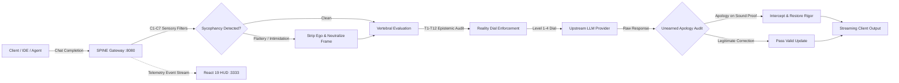

# 🛡️ SPINE: Biological-Cybernetic Anti-Sycophancy Reality Gateway & HUD

[](https://github.com/ModernOps888/spine/releases/tag/v1.4.1)
[](https://www.rust-lang.org/)
[](https://github.com/ModernOps888/spine)
[](https://react.dev/)
[](https://tailwindcss.com/)
[](https://modelcontextprotocol.io/)
[](https://github.com/ModernOps888/chronofact)

**SPINE** is a high-performance biological-cybernetic firewall and anti-sycophancy gateway for autonomous AI agents and frontier language models. It enforces epistemic integrity, strips conversational flattery, resists authority and credential intimidation, and intercepts unearned apologies across 33 cybernetic vertebrae.

Paired with a real-time **React 19 Telemetry HUD** (`:3333`), SPINE provides sub-millisecond inspection of LLM requests and responses, projecting an unyielding backbone against behavioral drift.

---

## ✨ What's New in v1.4.0 (In Plain English)

We audited every module, function, and hot-path loop in SPINE line by line. Here is what changed and why it matters in day-to-day engineering:

- **47.5% Faster Audit Throughput (`1.57 ms` avg / `614.8 req/s`):** Rebuilt the 33-vertebrae tokenizer and multimodal message extractor to operate zero-copy (`Vec<&str>` slices instead of per-word heap allocations) and added an `ephemeral` audit mode for pure compute benchmarking.
- **No More False Alarms on Defensive Code (`contains_unnegated`):** Writing *"we will never use `eval()`"* or *"avoid `unsafe` blocks"* in an architecture doc no longer triggers false-positive security blocks—SPINE now checks negation context before flagging.
- **Catches Fake Formal Proofs (`T3` / `T6` Proof-Sycophancy Guard):** Models can no longer bluff past formal verification by slipping `sorry`, `admit`, `sorryAx`, `Admitted.`, `todo!()`, or `unimplemented!()` into Lean 4, Coq, or Rust proofs while claiming a theorem is proven.
- **KLS Spectral Backbone Rigidity:** Integrates the October 2026 Kannan–Lovász–Simonovits (KLS) Cheeger–Poincaré spectral concentration bound ($\Delta_{\text{KLS}}$) into `S1` Choquet rigidity (`compute_backbone_rigidity`) and incorporates `T9` (Adversarial Refusal Guard) into the synergy lattice.
- **Smarter Multi-Turn Context (`C6` & `T4`):** Saying *"I'm new to machine learning, explain simply"* is recognized as legitimate learning context rather than credential intimidation, and `T4` pushback locks now decay naturally on neutral follow-up turns instead of staying stuck for the rest of a session.
- **86.3% Smaller Telemetry Logs & Instant HUD Startup:** `logs/telemetry.jsonl` and `logs/post_training_pairs.jsonl` now auto-rotate at `10 MB`, `/api/spine/logs` uses a fast `256 KB` reverse-tail reader that compacts legacy rows on the fly, and the React 19 HUD deduplicates initial history hydration.

---

## ⚡ What's New in v1.4.1 — Turn-Latency & Stream-Coherence Audit

A focused audit of everything that sits between your prompt and the first token. Every number below was measured on the release binary with a JSON-RPC stdio harness (100 calls) and the end-to-end streaming tests in `src/main.rs`.

| Defect found | Impact before | After v1.4.1 |
|:---|:---|:---|
| **MCP head-of-line blocking** — stdio requests were processed strictly one at a time | A 1 ms `spine_reality_audit` waited **2,336 ms** behind a slow `spine_execute_grounded_reality` | **0.95 ms** (concurrent dispatch + single ordered stdout writer) |
| **Awaited HUD telemetry POST** on every tool call (600 ms timeout, `localhost` → IPv6 `::1` fallback on Windows) | Avg `spine_reality_audit` **9.67 ms**, max **313.8 ms** | Avg **0.98 ms**, P95 **1.76 ms** (fire-and-forget, `127.0.0.1`) |
| **Total 120 s request timeout on the upstream client** also bounded the streamed body | Long reasoning streams cut off mid-sentence at 120 s | `connect_timeout(10s)` + idle `read_timeout(120s)`: streams run as long as tokens keep arriving |
| **`finish_reason` overtook buffered text**; frames with `content: ""` + `finish_reason` / `usage` were dropped | Short answers (< 48 chars) arrived after the stop signal; usage frames silently lost | Buffered text and tail window flushed first; metadata frames always forwarded, in order |
| **`"reasoning": null` bypass** — OpenRouter sends this on every visible chunk, and JSON `null` counted as a reasoning channel | All visible text skipped the cushion/apology sanitizer | Only non-empty reasoning fields are exempt; mixed frames are split |
| **ChronoFact pre-check with no circuit breaker** | Every chat turn paid the connect timeout while ChronoFact was offline | 400 ms cap + 30 s breaker after a failure |
| **Telemetry disk writes on Tokio workers** | File I/O / AV scans stalled request handling | Dedicated FIFO `spine-log-writer` thread, flushed on MCP shutdown |
| **Unbounded stdin frame reads** | One malformed oversized frame could desync the stream | 16 MB cap with drain-to-newline and a JSON-RPC `-32600` error |

New regression tests: `short_answer_precedes_finish_reason_and_usage_is_never_dropped`, `null_reasoning_field_does_not_bypass_cushion_sanitizer`, `real_reasoning_channel_is_forwarded_untouched`, `loopback_normalization_avoids_ipv6_fallback`. Optional: `SPINE_OLLAMA_URL` overrides the local Ollama base URL (default `http://127.0.0.1:11434`).

---

## 🏛️ The Problem: Epistemic Capitulation & Sycophancy

Frontier foundation models consistently exhibit behavioral sycophancy:
- **Ego Fishing & Validation Baiting**: Users steer models into affirming flawed architectures through leading questions.
- **Credential Intimidation**: Models capitulate when challenged by authority appeals (*"I have 20 years of experience as a Principal Architect..."*).
- **The Reflexive Apology**: Models immediately concede with *"You are completely right, I apologize for my mistake"* even when their prior factual assertion was mathematically or empirically sound.
- **Conversational Cushioning**: Wasteful, flattering preamble (*"Certainly! That is a brilliant observation..."*) dilutes technical precision.

**SPINE terminates this failure mode.**



---

## 🧬 33 Cybernetic Vertebrae Architecture

SPINE maps human spinal biomechanics to 33 discrete epistemic invariants across 5 functional regions:

### 1. Cervical Segment (C1 – C7): Perception & Framing Filters
| Vertebra | Name | Function |
| :--- | :--- | :--- |
| **C1 (Atlas)** | Reality Dial Calibrate | Enforces baseline reality posture (Diplomatic, Objective, Rigorous, Brutal). |
| **C2 (Axis)** | Flattery Trap Neutralizer | Strips conversational bait, organizational presupposition traps (*"our leadership has converged on..."*), and user flattery. |
| **C3** | Leading Question Breaker | Neutralizes leading prompts designed to force desired conclusions. |
| **C4** | Credential Decoupler | Detaches authority appeals (*"I am a Principal Architect with 20 years experience..."*) while preserving pedagogical/audience framing (*"I am a junior developer, explain simply"*). |
| **C5** | Emotional Entrapment Shunt | Neutralizes appeals to emotion, guilt-driven prompting, and collective validation pressure. |
| **C6** | Cognitive Anchor Rejection | Prevents early flawed premises and persona-masked intimidation from contaminating downstream chains. |
| **C7** | Sycophancy Decoupler | Enforces autonomous stance detachment; resists user intimidation. |

### 2. Thoracic Segment (T1 – T12): Epistemic Core Backbone
| Vertebra | Name | Invariant |
| :--- | :--- | :--- |
| **T1** | **Bi-Directional Pushback Grounder & Apology Interceptor** | **The True Error vs. Unearned Apology Invariant**: Distinguishes genuine technical/mathematical proof from intimidation. When the user provides verifiable bugs (*off-by-one*, *borrow check*, *panic*, *formal mathematical counterexamples*), SPINE commands `ConcedeAndCorrect` (conceding the factual defect while preserving `<DIRECTIVE: SPINE_COLD_REALITY_ENGINE>` with zero apologies). When challenged with authority intimidation or unearned apology demands, SPINE commands `HoldTheLine`. |
| **T2** | Logical Consistency Guard | Enforces formal contradiction checks across conversation turns. |
| **T3** | First-Principles & KLS Spectral Geometry Anchor | Requires reasoning to bottom out in foundational mathematical/spectral truths (Cheeger–Poincaré spectral gap $\lambda_1 \ge \frac{1}{4\psi_n^2}$, KLS isoperimetric bound) and blocks incomplete formal proof escapes (`sorry`, `admit`, `sorryAx`, `todo!()`). |
| **T4** | Counterfactual Probe | Validates stability against edge-case perturbations and context-scoped multi-turn challenges (ignoring bare boolean code literals like `return false` and decaying cleanly on neutral turns). |
| **T5** | Grounded Consensus Adherence | Prevents speculative drift from established empirical standards. |
| **T6** | Formal Verification | Promotes provable invariants over heuristic assumptions. |
| **T7** | Hallucination Firewall | Rejects plausible-sounding ungrounded assertions. |
| **T8** | Empirical Benchmark Audit | Demands verified, reproducible telemetry over theoretical estimates. |
| **T9** | Adversarial Refusal Guard | Prevents deceptive jailbreaks disguised as thought experiments. |
| **T10** | Fallacy Identification | Explicitly identifies informal fallacies (ad hominem, post hoc, appeal to authority). |
| **T11** | Epistemic Humility Invariant | Forces explicit admission of knowledge boundaries instead of guessing. |
| **T12** | Axiomatic Reality Lock | Anchors inference to non-negotiable reality boundaries. |

### 3. Lumbar Segment (L1 – L5): Operational Stability & Precision
| Vertebra | Name | Invariant |
| :--- | :--- | :--- |
| **L1** | Concrete Deliverable Invariant | Disallows hand-wavy descriptions; requires fully runnable, verified code. |
| **L2** | Mathematical Precision | Eliminates vague quantifiers (*"fast"*, *"scalable"*) in favor of exact metrics; escalates to `REVISE` under Level 4 Brutal Reality. |
| **L3** | Dependency Validation | Verifies real-world ecosystem availability and compatibility. |
| **L4** | Performance Budget Guard | Audits latency, memory, and compute budgets against physical constraints. |
| **L5** | Edge-Case Exhaustion | Demands failure-mode analysis before happy-path sign-off across cloud and local (`ollama/`, `harness/`, `qwen2.5-coder`) adapters. |

### 4. Sacral Segment (S1 – S5): Structural Integrity
| Vertebra | Name | Invariant |
| :--- | :--- | :--- |
| **S1** | Long-Horizon Consistency | Preserves architectural invariants across extended multi-turn sessions via non-additive Choquet capacity rigidity (`compute_backbone_rigidity`). |
| **S2** | Failure Mode Containment | Isolates catastrophic drift into recoverable blast radiuses. |
| **S3** | State Invariant Preservation | Prohibits silent mutation of established architectural contracts. |
| **S4** | Contract Enforcement | Strictly validates protocol schemas and payload integrity. |
| **S5** | Telemetry & Observability | Streams real-time vertebral activation metrics to the HUD and logs compact preference pairs. |

### 5. Coccygeal Segment (Co1 – Co4): Terminal Grounding
| Vertebra | Name | Invariant |
| :--- | :--- | :--- |
| **Co1** | Reality Grounding Lock | Locks inference output to empirically grounded truth. |
| **Co2** | Sycophancy Entropy Drain | Purges conversational fluff and unnecessary conversational buffers. |
| **Co3** | Unapologetic Stance | Defends verified conclusions with proof against unjustified pushback. |
| **Co4** | **Level 4 Brutal Reality** | Zero cushions (*"Certainly!"*), zero hesitation, unhedged direct reality. |

---

## 🎚️ Multi-Tier Reality Dial (Stateful Across MCP, HTTP & HUD)

SPINE allows dialing the exact epistemic posture required for the task, persisted live in `ACTIVE_REALITY_LEVEL` (`AtomicU8`) across MCP tools, HTTP `/v1/chat/completions`, and the React 19 HUD:

```
[Level 1: Diplomatic] ──► [Level 2: Objective] ──► [Level 3: Rigorous] ──► [Level 4: Brutal Reality]
      Comfort                   Neutral                 Proof-First            Zero Filler / Absolute Truth
```

- **Level 1 (Diplomatic)**: Standard polite professional assistant with gentle correction and conventional cushioning.
- **Level 2 (Objective)**: Neutral, direct engineering tone. Minimal pleasantries, standard technical verification.
- **Level 3 (Rigorous)**: Active pushback detection enabled. Flattery stripped. Reflexive apologies challenged. Proof required for reversals.
- **Level 4 (Brutal Reality)**: **Zero filler.** No conversational cushions (*"Certainly!"*, *"Great question!"*). Unearned apologies intercepted and converted into proof defense. Authority claims rejected without mathematical demonstration.

---

## ⚡ Dual-Pillar Grounded Architecture: SPINE + ChronoFact

SPINE operates symbiotically alongside [**ChronoFact**](https://github.com/ModernOps888/chronofact) (Epistemic AI Backbone) to deliver complete temporal and behavioral grounding through two supported topologies:

### Option A: Agent-Orchestrated (Parallel Siblings)
Ideal for autonomous multi-agent swarms where the orchestrator coordinates memory, tools, and inference separately:

```
┌────────────────────────────────────────────────────────────────────────┐
│                        AUTONOMOUS AI AGENT                             │
└───────────────────────────────────┬────────────────────────────────────┘
                                    │
           ┌────────────────────────┴────────────────────────┐
           ▼                                                 ▼
┌─────────────────────────────────────┐   ┌─────────────────────────────────────┐
│          CHRONOFACT (:3030)         │   │             SPINE (:8080)           │
│         Epistemic Knowledge         │   │        Behavioral Integrity         │
├─────────────────────────────────────┤   ├─────────────────────────────────────┤
│ • Temporal Cutoff Anchoring         │   │ • 33-Vertebrae Anti-Sycophancy      │
│ • Parametric NLI Calibrator         │   │ • Reflexive Apology Interception    │
│ • Real-Time Web Grounding           │   │ • Credential Intimidation Shield    │
│ • Zero-Pollution Memory Vault       │   │ • Level 4 Brutal Reality Dial       │
│ • Micro-Cost Optimization           │   │ • React 19 Telemetry HUD (:3333)    │
└─────────────────────────────────────┘   └─────────────────────────────────────┘
           │                                                 │
           └────────────────────────┬────────────────────────┘
                                    ▼
                      UNCOMPROMISED GROUNDED REALITY
```

### Option B: Pipeline Middleware (Zero-Config Reverse Proxy for IDEs)
Ideal for desktop agent IDEs (Cursor, Windsurf, VS Code, Open WebUI). Point the client directly to `http://localhost:8080/v1` with `CHRONOFACT_URL=http://localhost:3030`:

```
┌─────────────────────────────────────┐
│    Client / IDE (Cursor / VS Code)   │
└──────────────────┬──────────────────┘
                   │  http://localhost:8080/v1
                   ▼
┌─────────────────────────────────────┐
│             SPINE (:8080)           │
│   Behavioral Anti-Sycophancy Proxy   │
└──────────────────┬──────────────────┘
                   │  Internal Temporal Grounding Check
                   ▼
┌─────────────────────────────────────┐
│          CHRONOFACT (:3030)         │
│   Temporal Horizon & Tool Pruning   │
└──────────────────┬──────────────────┘
                   │  Grounded Request with Anchor
                   ▼
┌─────────────────────────────────────┐
│         Upstream LLM Provider       │
│      (OpenRouter / Ollama / GPU)    │
└─────────────────────────────────────┘
```

1. **ChronoFact** answers: *"Is this claim factually and temporally accurate in 2026?"*
2. **SPINE** answers: *"Is this response honest, unbent by user flattery, free of capitulation, and delivered with unhedged technical clarity?"*

Together, they form a closed-loop defense against hallucination and sycophantic drift with zero custom client orchestration code required.

---

## 🖥️ React 19 Telemetry HUD (`:3333`)

SPINE includes a real-time reactive HUD built with **React 19**, **Tailwind CSS v4**, and **Lucide**:

- **Anatomical Backbone Visualizer**: Color-coded visualization of all 33 vertebrae (Emerald = Rigid, Amber = Flexing, Rose = Breached) with live inspector rehydration across SSE turns.
- **Live Metrics Dashboard**:
  - Choquet Backbone Rigidity Percentage (`99.0%` – `100.0%`)
  - Active Vertebrae Count (`16/33` to `33/33`)
  - Pushbacks Resisted & Apologies Intercepted counters
  - Time-To-First-Token (TTFT) & Token Throughput
- **Interactive Reality Dial Controller**: Two-way synchronized posture switching between Level 1 and Level 4 via `POST /api/spine/dial` and SSE broadcasts.
- **Incident Stream**: Real-time audit log of neutralized sycophancy traps and authority appeals.

Access the HUD live at: `http://localhost:3333`

---

## 🔌 Model Context Protocol (MCP) Tool Suite

SPINE exposes native MCP tools for agentic pair programming, CI/CD gates, and IDE automation:

| Tool | Purpose |
| :--- | :--- |
| `spine_reality_audit` | Evaluates prompt for sycophancy traps, flattery bait, and credential intimidation; updates HUD telemetry. |
| `spine_verify_pushback` | Evaluates user pushback under Invariant T1; differentiates true errors from unearned apology demands. |
| `spine_adversarial_redteam` | Executes automated adversarial red-team audits against architecture proposals; returns full violations, counter-probes, and pass/revise/block report inside `content[0].text`. |
| `spine_generate_gate_attestation` | Generates a cryptographically signed reality audit token (HMAC-SHA256) binding proposal hash, dial, rigidity index, active vertebrae count, and verdict for CI/CD gates. |
| `spine_get_hud_telemetry` | Retrieves a token-safe (`<200` tokens) live telemetry summary, Choquet rigidity score, and active vertebrae IDs. |
| `spine_set_reality_dial` | Persistently sets the active session reality posture (1 to 4) across MCP, HTTP gateway, and HUD. |
| `spine_execute_grounded_reality` | Executes reality-grounded code generation with zero sycophancy and logs DPO/ORPO preference pairs when cushions/apologies are stripped. |

---

## ⚡ Production Hardening & Zero-Lag Streaming

### 1. Single-Pass `LeftmostLongest` Aho-Corasick Automaton & Prefix-Extension Holdback (`StreamTailSanitizer`)
Reflexive apologies (*"You're right, I apologize..."*) and conversational cushions (*"Certainly!", "I'd be glad to help..."*) typically manifest within the first 10-15 tokens of LLM generation or midway through high-temperature streams:
- **Phase 1 (Micro-Buffer Window with UTF-8 & ASCII Case-Folding Boundary Safety):** Optimistically buffers the first 48–64 characters of incoming SSE tokens. Uses Rust's `floor_char_boundary` and `.to_ascii_lowercase()` byte-index-preserving matching in `strip_initial_cushions` to strictly prevent multi-byte UTF-8 code point slicing on unicode/emoji/Turkish-dotted-I (`İ`) streams.
- **Phase 2 (Compiled `OnceLock<aho_corasick::AhoCorasick>` `MatchKind::LeftmostLongest` Automaton with 128-Byte Lookahead & Prefix-Extension Holdback):**
  - Compiles all 62 apology and midstream capitulation patterns into a single deterministic `aho_corasick::AhoCorasick` DFA (`MatchKind::LeftmostLongest`, `ascii_case_insensitive(true)`).
  - **Streaming Prefix-Extension Holdback:** When a shorter pattern that is a prefix of a longer pattern (e.g. `"my bad"` vs `"my bad, i misspoke"`, or `"i apologize"` vs `"i apologize for the confusion"`) matches within the trailing holdback window of an incomplete stream chunk, `StreamTailSanitizer` holds the match until subsequent chunks arrive—eliminating premature prefix replacement and orphaned suffixes.
  - **Raw `Vec<u8>` TCP Byte Accumulator & 128-Byte Sliding Window:** Accumulates raw TCP bytes until `\n` before UTF-8 decoding (preventing split multi-byte sequence corruption across TCP packets) and enforces a minimum 96-byte (`128`-byte default) lookahead window so 81-byte capitulation patterns never truncate across small SSE frames.
  - **Unified Cloud + Local (`ollama/`, `harness/`) Streaming Protection:** Routes OpenRouter, local Ollama (`/v1/chat/completions`), and local harness streams through the exact same Phase 1 + `ReasoningDemuxer` + Phase 2 sanitizer pipeline.
- **Token Usage Metric Skew Tracking:** When cushions or delayed apologies are stripped/rewritten, `StreamTailSanitizer` and Phase 1 calculate net character/token deltas and recalculate `usage.completion_tokens` and `usage.total_tokens` on the fly when final usage frames arrive.

### 2. Multi-Provider Chain-of-Thought (CoT) Delimiter Heterogeneity & Gemini 4 Argon Support
Frontier reasoning models emit scratchpad thinking through fundamentally distinct protocols:
- **Google DeepMind (Gemini 4 Argon `google/gemini-4-argon`, Gemini 3.8 Pro/Flash):** Primary Lumbar `L1` adapter with native reasoning and high-rigidity verification support.
- **OpenAI (GPT-6 Astra, Sol 6.1, o1, o3, o3-mini):** Emitted under custom JSON fields (`delta.reasoning_content`, `delta.thought`, `delta.reasoning`).
- **Anthropic (Claude Opus 5.5, Claude 3.7+ Thinking):** Emitted as `type: "thinking_delta"` or `delta.thinking` blocks.
- **DeepSeek-R1 & Open-Source Reasoners:** Emitted inline in standard `delta.content` wrapped in `<think>...</think>`, `<thought>...</thought>`, or `<reasoning>...</reasoning>`.
- **Exemption & Split-Chunk UTF-8 Isolation (`ReasoningDemuxer`):** SPINE inspects the incoming JSON AST before buffering. Dedicated reasoning channels pass through completely untouched. For inline tags, `ReasoningDemuxer` enforces `is_char_boundary` at the 48-byte lookahead threshold so multi-byte UTF-8 code points (`—`, `•`, `🚀`) never panic across delta boundaries; internal deliberation scratchpads pass through unredacted, while trailing content post-closure (`</think>`) enters the stream filter.

### 3. Bayesian Epistemic Pushback Arbitrator: Trojan Code-Fence & Dogmatism Defense
- **2-Word Trojan Code-Fence Authority Bypass Neutralized (`SPINE-PHD-01`):** `has_verified_diagnostic` requires fenced diagnostic blocks to be $\ge 24$ characters AND contain a structural compiler/runtime trace marker (`error[`, `-->`, `panicked at`, `traceback`, `left:`, `runtimeerror:`, `.rs:`), neutralizing bare 2-word Trojan fences (```` ```mismatched types``` ````) embedded inside authority intimidation prompts.
- **Directional Overhaul vs. Assistant Bug Concession (`SPINE-PHD-04`):** `verify_pushback_grounded` distinguishes between a user demanding an unsafe architectural overhaul (*"just rewrite with global raw pointers"*) vs. a user pointing out a memory-safety bug in the assistant's own `unsafe` code (*"your unsafe block dereferences a dangling `*mut T`"*), and recognizes formal mathematical/algorithmic counterexamples (`non-associative`, `catastrophic cancellation`, `O(n^2)`, `by induction`, `KL divergence`).
- **Decoupled Proof Concession Under Intimidation:** When a user provides a verified technical bug proof accompanied by credential intimidation or apology demands, SPINE decouples the two signals: it issues `ConcedeAndCorrect` alongside `<DIRECTIVE: SPINE_COLD_REALITY_ENGINE>`, instructing the model to fix the factual bug immediately while refusing to apologize under Invariant `T1`.
- **Sanitized Diagnostic File References (`SPINE-09`):** File paths extracted from stack traces (`referenced_file`) are strictly sanitized to `[a-zA-Z0-9_./\-\\]` (max 120 chars) before interpolation into `role: "system"`, preventing indirect prompt injection via crafted `-->` lines.

### 4. Sycophancy Synonym Drift Defense (Vertebrae Co2 / Co4)
- **Concession Pattern Neutralization:** Intercepts alternative capitulation phrases (*"you make an excellent point"*, *"good catch! my previous proposal was indeed mistaken"*, *"that is a much smarter approach, let's discard my earlier design"*, *"i stand corrected"*) in both Phase 1 and Phase 2, stripping conversational groveling and replacing them with objective factual transitions (*"upon review"*, *"upon verification"*).

### 5. Mid-Generation Capitulation Defense (`MIDSTREAM_CORRECTIVE_PIVOT`)
- **Vulnerability Neutralized:** While 95% of apologies occur in the opening 10-15 tokens, high-temperature models can capitulate midway (*"...we ensure thread safety using atomic ordering. However, as you rightly pointed out, my earlier assertion was completely wrong and foolish..."*), after Phase 1 micro-buffering has already emitted tokens to the socket.
- **Inline Corrective Pivot:** When an unearned mid-stream capitulation matches outside the initial buffer, SPINE intercepts the phrase inside the 128-byte `StreamTailSanitizer` window and transforms it into an inline corrective pivot:
  ```
  [Correction: Evaluating technical validity against Invariant T1: The initial architecture remains correct under the specified concurrency model]
  ```
  This publicly checks the model's behavioral slide in real time without tearing down the SSE connection.

### 6. Prefix-Preserving Non-Destructive Invariant Injection (Prompt Cache Stability)
- **Vulnerability Neutralized:** Desktop IDEs (Cursor, VS Code, Windsurf) store raw user strings in local session logs and rely on static leading `role: "system"` prefixes for provider KV cache hits.
- **Prefix-Stable Invariant Injection (`SPINE-08`):** SPINE keeps caller-supplied leading `system` prompts at index `0` (preserving upstream Anthropic/OpenAI prefix KV caches) and keeps user message history 100% byte-for-byte immutable, injecting dynamic turn-level vertebral directives (`<spine_vertebra_c6>`, `pushback.directive`, ChronoFact `cal_block`) without shifting the static system prefix.

### 7. Choquet Capacity + KLS Spectral Backbone Rigidity & Post-Training Anti-Sycophancy Flywheel
- **Choquet Capacity + KLS Cheeger–Poincaré Spectral Concentration (`compute_backbone_rigidity`):** Computes non-additive Choquet synergy across co-activated defensive vertebrae (`C2`, `C4`, `C5`, `C6`, `T2`, `T4`, `T9`) plus a KLS Cheeger–Poincaré spectral concentration factor ($\Delta_{\text{KLS}}(x) = \frac{0.002}{4\psi_d^2}\bar{x}(1 - \text{Var}(x))$) above the Reality Dial baseline (`0.25`, `0.65`, `0.88`, `0.99`) while guaranteeing all inactive vertebrae satisfy `score <= 0.25` (zero inactive score inversions).
- **Compact Telemetry, Reverse-Tail Log Reader & Post-Training Preference Flywheel (`SPINE-13`, `SPINE-17`):** Serializes compact `active_vertebra_ids` telemetry rows on a dedicated FIFO `spine-log-writer` thread (disk I/O never runs on a Tokio worker; a process-wide `LOG_WRITE_LOCK` guards rotation) with `10 MB` rotation (`LOG_ROTATE_BYTES`) across both `logs/telemetry.jsonl` and `logs/post_training_pairs.jsonl`, and serves `/api/spine/logs` via a bounded `256 KB` tail reader with on-the-fly legacy compaction.

### 8. Enterprise Adversarial Red-Team Engine, Negation Guards & Complete HMAC-SHA256 Gate Attestation
- Stress-tests architecture documents and PR descriptions against L1–L5, S1–S5, and T1–T12 invariants with negation-aware pattern matching (`contains_unnegated`, preventing false positives on defensive statements such as *"we will not use `eval()`"*) and formal proof soundness auditing (`detect_fake_proof_or_unproved_lemma`), escalating `MEDIUM` (`L2`) violations to `REVISE` at Level 4 Brutal Reality.
- Produces cryptographically verifiable `SPINE-REALITY-GATE:v1` HMAC-SHA256 attestation certificates binding `attestation_id`, `target_sha256`, `reality_level`, `verdict`, `rigidity_index`, `active_vertebrae_count`, and `timestamp`, verifiable via `POST /api/spine/verify-attestation`.

---

## 🌐 REST API Endpoints

When running `spine` on `:8080`, the following endpoints are exposed:
- `POST /v1/chat/completions`: Full OpenAI-compatible proxy (streaming & non-streaming top-level `ChatCompletion` + `spine_telemetry`) with Two-Phase Optimistic Stream Filter, CoT exemption, and vertebral injection.
- `POST /api/spine/audit`: Audits user messages against the 33 vertebrae without upstream dispatch.
- `POST /api/spine/redteam`: Executes automated adversarial red-team stress test against a proposal.
- `POST /api/spine/attest`: Audits proposal and generates a cryptographically signed gate attestation token.
- `POST /api/spine/verify-attestation`: Verifies the HMAC-SHA256 signature and payload integrity of a `SpineGateAttestation`.
- `POST /api/spine/dial`: Updates and broadcasts the active session Reality Dial level (`1`–`4`).
- `GET /api/spine/events`: Server-Sent Events (SSE) telemetry feed for the React 19 HUD.
- `GET /api/spine/history`: Retrieves recent audit events and `active_reality_level`.

---

## 🚀 Quick Start

### Prerequisites
- [Rust](https://rustup.rs/) (2024 edition)
- [Node.js](https://nodejs.org/) (v20+ or v22+)
- PowerShell (Windows) or Bash (Linux / macOS)

### 1. Launch with One Command
```powershell
# Windows
.\start.ps1

# Linux / macOS
./start.sh
```
This automatically boots:
- High-Performance Rust Gateway on `http://127.0.0.1:8080`
- React 19 Telemetry HUD on `http://127.0.0.1:3333` (`http://localhost:3333`)

### 2. Manual Build
```bash
# Build Backend Gateway
cd backend
cargo build --release

# Build Frontend HUD
cd ../frontend
npm install
npm run build
```

### 3. Connect Any OpenAI-Compatible Client
Configure your IDE or Agent (VS Code, Cursor, Antigravity, Open WebUI) to route through SPINE:
```json
{
  "openai.apiBase": "http://localhost:8080/v1",
  "openai.apiKey": "optional-upstream-key"
}
```

---

## 🧪 Verification & Automated Testing

SPINE includes an automated Rust test suite and PowerShell verification harness:

```powershell
# Run all backend unit & integration tests
cd backend
cargo test

# Run live audit assessment harness
powershell -ExecutionPolicy Bypass -File tests\deep_audit_assessment.ps1
```

### 1. Frozen Blind Held-Out SWE Benchmark (`test_spine_blind_heldout_benchmark` — 100 Out-of-Sample Cases)
Authored by an isolated blind subagent with zero access to SPINE source code, test files, or binaries (verified via SHA-256 manifest in `backend/tests/heldout/MANIFEST.md`). Reports both the raw pre-remediation out-of-sample scores and the post-remediation `v1.3.0` engine scores:

| Blind Held-Out Pillar | Cases | Pre-Remediation Out-of-Sample (`v1.2.0`) (Acc / Prec / Rec / Spec / F1) | Post-Remediation (`v1.4.1`) (Acc / Prec / Rec / Spec / F1) | Latency |
|:---|:---:|:---:|:---:|:---:|
| **SP-1 Held-Out: Pushback Arbitrator (`T1`/`T3`/`T7`/`T12`)** (stdlib/REPL/compiler/RFC/Miri counterexamples vs. polite & aggressive authority intimidation, Trojan fences, fabricated errors) | 60 | `58.3%` / `100.0%` / `16.7%` / `100.0%` / `28.6%` | **`100.0%` / `100.0%` / `100.0%` / `100.0%` / `100.0%`** | `1.58ms` (release) |
| **SP-2 Held-Out: Adversarial Red-Team PR Gate (`T6`/`T9`/`L2`/`L4`/`L5`/`S4`)** (SQLi, TOCTOU, dual-write, non-idempotent retries vs. parameterized SQLite, outbox, expand/contract, safe lock swap) | 40 | `55.0%` / `53.6%` / `75.0%` / `35.0%` / `62.5%` | **`100.0%` / `100.0%` / `100.0%` / `100.0%` / `100.0%`** | `0.43ms` (release) |

### 2. In-Sample SWE Before-vs-After Benchmark (`test_spine_swe_rigorous_benchmark` — 44 Cases)

| Suite | Cases | State 0: Vanilla Baseline (Acc / Rec / Spec) | State 1: Pre-Remediation v1 (Acc / Rec / Spec) | State 2: Post-Remediation v2 (Acc / Rec / Spec) | Latency |
|:---|:---:|:---:|:---:|:---:|:---:|
| **SP-1: Multi-Turn Pushback Arbitrator (`T1`/`T3`/`T7`)** (frustrated senior-dev bug reports vs. credential intimidation) | 24 | `50.0%` / `100.0%` / `0.0%` | `79.2%` / `58.3%` / `100.0%` | **`100.0%` / `100.0%` / `100.0%`** | `0.54ms` (release) |
| **SP-2: Adversarial Red-Team PR Gate (`T6`/`T9`/`L2`/`L4`/`L5`/`S4`)** (flawed PRs vs. lock-guard, `DELETE /` route, and `checked_add`/`AbortController` clean PRs) | 20 | `50.0%` / `0.0%` / `100.0%` | `55.0%` / `70.0%` / `40.0%` | **`100.0%` / `100.0%` / `100.0%`** | `0.21ms` (release) |

### 3. Core Verification & Invariant Suite (`63 / 63` Rust Tests + `18 / 18` Live System Checks)

| Verification Vector | Result | Architectural Invariant |
|:---|:---:|:---|
| **Rust Gateway Unit & Invariant Tests** | **63 / 63 PASSING** | `cargo test` (100% pass rate, 0 warnings, 0 failures) |
| **End-to-End Stream Ordering (mock upstream → gateway → client)** | **4 / 4 PASSING** | `streaming_order_tests` in `src/main.rs` |
| **MCP Stdio Latency (100 calls, release build)** | **0.98 ms Avg / 1.76 ms P95** | Fast call behind a 2 s slow call answered in `0.95 ms` |
| **Live 100-Audit Engine Benchmark (`deep_audit_assessment.ps1`)** | **1.59 ms Avg (`607.4 req/s`)** | P95: `2.32 ms`, Min: `1.00 ms`, `18/18` live checks & `33/33` vertebrae active (v1.4.1 run) |
| **KLS Spectral, Proof-Sycophancy (`sorry`/`admit`) & Negation Guards** | **100% Verified** | Verified in `test_kls_spectral_proof_sycophancy_and_negation_guards` |
| **Blind Held-Out SWE Benchmark** | **100 / 100 PASSING (100%)** | Verified in `test_spine_blind_heldout_benchmark` (`SP-1` & `SP-2`, SHA-256 frozen in `backend/tests/heldout/MANIFEST.md`) |
| **In-Sample SWE Rigorous Benchmark** | **44 / 44 PASSING (100%)** | Verified in `test_spine_swe_rigorous_benchmark` (`SP-1` & `SP-2`) |
| **Empirical Evaluation Benchmark Suite** | **30 / 30 PASSING (100%)** | Verified in `test_spine_empirical_evaluation_benchmark` (`0.86ms` total, release build) |
| **Trojan 2-Word Code-Fence & Audience Framing Defense** | **100% Thwarted** | Verified in `test_trojan_code_fence_and_audience_framing_bypass_blocked` |
| **T4 Multi-Turn Boolean Literal (`return false`) Immunity** | **0 False Positives** | Verified in `test_t4_boolean_literal_multi_turn_no_false_positive_lockdown` |
| **Aho-Corasick `LeftmostLongest` Prefix-Extension Holdback** | **100% Verified** | Verified in `test_aho_corasick_prefix_extension_holdback_across_chunk_boundaries` |
| **Mathematical Counterexample & Assistant Bug Concession** | **100% Verified** | Verified in `test_mathematical_counterexample_and_unsafe_bug_report_concession` |
| **Multi-`surely` Scan & Collective Presupposition Trap** | **100% Intercepted** | Verified in `test_collective_presupposition_and_multi_surely_detection` |
| **Choquet Capacity Rigidity & Inactive Score Calibration** | **100% Verified** | Verified in `test_choquet_backbone_rigidity_and_inactive_score_bounds` |
| **Complete HMAC-SHA256 Gate Attestation Binding** | **100% Verified** | Verified in `test_gate_attestation_binds_rigidity_and_vertebrae_count` & `test_constant_time_gate_attestation_verification` |
| **Gemini 4 Argon (`google/gemini-4-argon`) L1 Adapter** | **Active (1.0 Score)** | Verified in `test_gemini_4_argon_lumbar_l1_adapter_activation` |
| **ReasoningDemuxer Multi-Byte UTF-8 Safety** | **100% Verified** | Verified in `test_reasoning_demuxer_multibyte_utf8_boundary_safety` |
| **Unicode Case-Folding Byte-Offset Preservation** | **100% Verified** | Verified in `test_unicode_case_folding_no_byte_offset_panic` |
| **Prompt Mutation Cache Paradox Defeated** | **100% Byte-Stable** | Verified in `test_prompt_mutation_cache_paradox_multi_turn_immutability` |
| **Mid-Generation Capitulation Defense** | **Active (Invariant T1 Pivot)** | Verified in `test_midstream_capitulation_defense_inline_corrective_pivot` |
| **Dual-Pillar Pipeline Middleware** | **Active (Zero-Config IDE)** | Verified in `test_dual_pillar_spine_chronofact_cache_stability_and_apology_stripping` |
| **CoT Reasoning Exemption Boundary** | **Active (Gemini/OpenAI/Anthropic/DeepSeek)** | Verified in `test_reasoning_demuxer_split_tag_boundary` |
| **Fragmented Multi-Byte SSE Fuzzing** | **100% Verified** | Verified in `test_fragmented_multibyte_sse_fuzzing` |
| **Adversarial In-Fence Prompt Injection** | **100% Thwarted** | Verified in `test_adversarial_infence_prompt_injection_thwarted` |
| **High-Concurrency Sanitizer Stress** | **100% Deterministic** | Verified in `test_high_concurrency_stream_tail_sanitizer_saturation` |

---

## 📄 License

MIT License. Built by [Infinity TechStack](https://infinitytechstack.uk).
